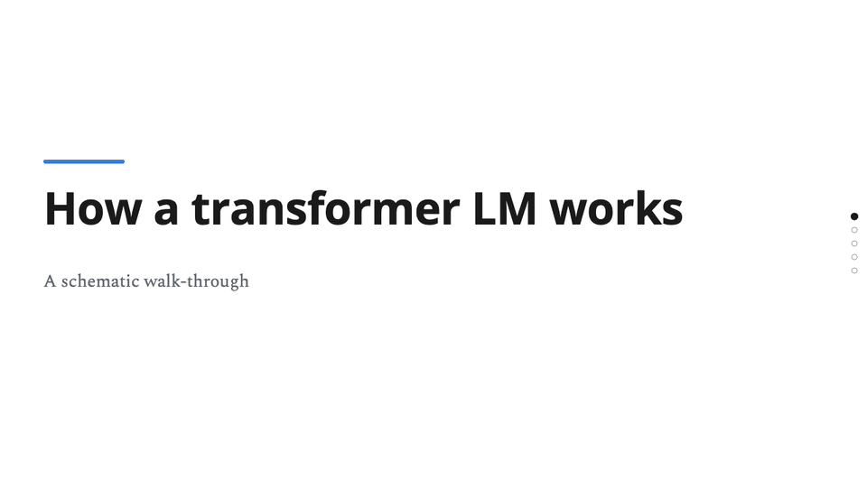

# research-talk-slides

A Claude skill that builds research-talk slides as interactive HTML on a fixed kit: you
describe a slide, it writes a small fragment, splices it into the kit, and screenshots every
reveal step to check it before you see it.



*Synthetic demo deck ([examples/](examples/)); all values are illustrative.*

## Installation

**There are three ways to install this. They are alternatives: pick the one that matches how
you use Claude.**

### Option A — claude.ai or the Claude app (no terminal)

1. Download **`research-talk-slides.zip`** from the
   [latest release](https://github.com/OrrZwebner/research-talk-slides/releases/latest). Don't unzip it.
2. In Claude, open **Customize → Skills** (older apps: **Settings → Capabilities → Skills**),
   click **Upload skill**, choose the file, and switch the skill on.

Use the release file, not the green **Code → Download ZIP** button: that gives you the whole
repository, which is not a valid skill upload.

### Option B — Claude Code, as a plugin

```
/plugin marketplace add OrrZwebner/research-talk-slides
/plugin install research-talk-slides@research-talk-slides
```

### Option C — Claude Code, as a standalone skill

Copy `skills/research-talk-slides/` into `~/.claude/skills/` (personal) or `.claude/skills/`
(one project).

Screenshot verification needs Python 3 and Playwright:
`pip install playwright && python -m playwright install chromium`.

## Usage

- "Make a slide for my talk showing our pipeline: A → B → C, reveal one stage per click."
- "Add an overview slide whose three components open detail slides."
- "Check my slide at 1024×768 and fix anything that clips."

## License

MIT — see [LICENSE](LICENSE).
